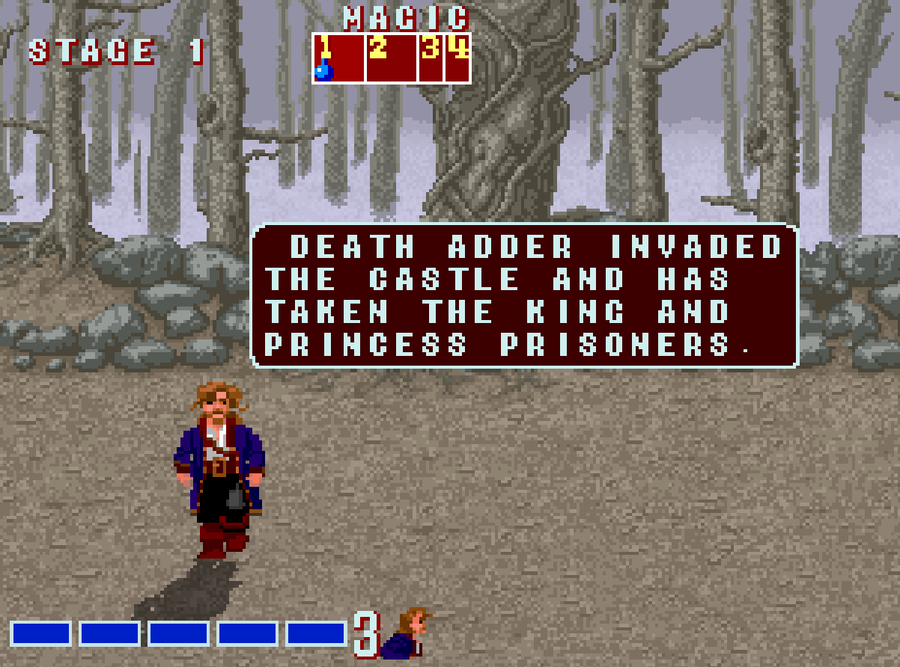

# Golden Axe — Guybrush Threepwood mod

A playable Golden Axe remake in pure Java (Java2D/AWT/Swing/Java Sound, no
external libraries), with **Guybrush Threepwood** from *Monkey Island 2: LeChuck's
Revenge* as the first player character (the slot that used to be Ax Battler) — on
the select screen, in stage, in the HUD and in the ending.

---

## ▶ Play now (Windows) — nothing to build

> **Easiest:** download the ready-to-run jar from the
> [latest release](https://github.com/MoreColors123/monkey-axe/releases/latest), or
> get the whole repo via **Code → Download ZIP**. Then follow the two steps below.

1. **Install Java 17** (Temurin JRE):
   <https://adoptium.net/temurin/releases/?version=17>
   pick *Operating System: Windows → Architecture: x64 → Package Type: JRE →
   `.msi`*, run the installer (default options are fine).
2. **Double-click `Play.bat`** in this folder.

That's the whole install — the game and all its art, music and sound are inside
`GoldenAxe.jar`. (If `java` is already on your PATH, `java -jar GoldenAxe.jar`
works from any OS.)

> If Java isn't found, `Play.bat` opens the download page for you and waits.

## Controls

- Arrows — move · `O` attack · `P` jump · `I` magic
- `F12` fullscreen · `F11` toggle aspect ratio
- 2P: `WASD` move · `G` attack · `H` jump · `F` magic

## Cheats (hidden)

Type the word **`ape`** anywhere in-game to open the cheat menu (UP/DOWN to
navigate, ENTER to toggle/activate, ESC to close):

- **STAGE SELECT** — jump to any stage (type `1`–`9`, ENTER)
- **MOUNT BEAST** — spawn a mountable beast beside you
- **AUTO-KILL ENEMIES**, **NO THIEVES**, **INVINCIBLE PLAYER**

---

## Building from source (developers)

Needs a **JDK 17** (not just a JRE). No Ant required.

- **`Play.bat`** — play (uses the committed `GoldenAxe.jar`).
- **`GoldenAxe.bat`** — compile the sources and play (uses `run.ps1`; `.\run.ps1 -Rebuild` forces a recompile).
- **`BuildRelease.bat`** — rebuild the shippable `GoldenAxe.jar` (game + assets).
- **`BuildSprites.bat`** — re-bake the Guybrush sprites from `mapping.json`.
- **`ReviewSprites.bat`** — open the sprite mapper (`reviewer.html`).
- **`ViewAnimations.bat`** — open a playable move sandbox (`viewer.html`).

The sprite tools also need **Python 3** with Pillow + numpy. See `HANDOFF.md`
and `REVIEWER.md` for the full pipeline.

---

## Credits

- Original Golden Axe remake by **Leonardo Ono** —
  <https://github.com/leonardo-ono/JavaGoldenAxe>
- Java GoldenAxe clone this fork is based on —
  <https://github.com/derek-keeler/GoldenAxeClone>
- Guybrush Threepwood sprites ripped from *Monkey Island 2* by **Ultimecia**
  (spriters-resource) — keep the credit.
- References: <https://goldenaxe.fandom.com/wiki/Main_Page>
